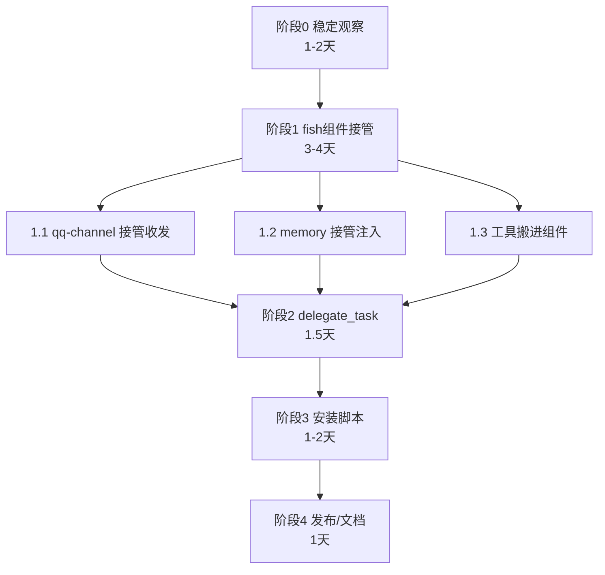

# fish 插件 · 工作线路

**制定日期**：2026-10-30
**当前状态**：总目录 ✅ / 插件骨架 ✅ / 基础接入 ✅ / 功能接管 ⏳ / 派活 ⏳ / 安装 ⏳

---

## 总览



---

## 阶段 0：稳定观察（1~2 天）

**目标**：确认当前系统稳定，不急着改代码。

| 任务 | 验收 |
|---|---|
| 观察小鱼日常聊天 | 3 天无异常（不掉线/不报错） |
| 检查开机自启 | 重启一次，服务自动起来 |
| 检查桥接日志 | 无重复错误 |
| 收集问题 | 记录到 `D:\fish\交接\问题清单.md` |

**不做**：不碰工作区、不改数据文件。

---

## 阶段 1：fish 组件接管（3~4 天）

**目标**：让 fish 插件真正干活，而不是“接上了但没接管”。

### 1.1 qq-channel 接管收发（1~1.5 天）
- 把 bridge.js 的 QQ 收发逻辑搬进 `components/qq-channel`
- 组件负责：连 SnowLuma、收消息、发消息、唤醒/已读
- 桥接变成“纯传输层”，只负责把消息递给 fish 组件

**验收**：断开 bridge.js 的旧收发逻辑后，小鱼仍能聊天。

### 1.2 memory 接管注入（1 天）
- 把 BLUEPRINT/ARCHIVE/shared-chat 的注入逻辑搬进 `components/memory`
- 组件负责：读记忆、注入 prompt、记录对话

**验收**：新会话能读到 BLUEPRINT，共享记忆正常。

### 1.3 工具搬进组件（1.5 天）
- `admin-tools`：接管 mcp-qq-admin 的能力（资料/状态/说说/撤回）
- `device-control`：接管 mcp-android（截图/点击/shell）
- `search`：接管 mcp-web-search-safe

**验收**：群会话仍受限（只能聊天），管理员私聊有完整工具。

---

## 阶段 2：delegate_task 派活（1.5 天）

**目标**：小鱼干不了的活，派给完整工具的 worker。

```
QQ 小鱼 → delegate_task(task)
  → 桥接创建/复用 web 的 standard 会话
  → worker 干活 → 结果回小鱼
```

| 子任务 | 时间 |
|---|---|
| 桥接加 `delegate_task` 工具 | 半天 |
| worker 会话管理（创建/复用/超时） | 半天 |
| 联调（判断→派活→回话） | 半天 |

**验收**：QQ 里说“看看 D:\fish 目录”，小鱼能派活并返回结果。

**安全**：worker 工作目录限制在 `D:\fish` + `D:\her-memory`，不能乱动。

---

## 阶段 3：安装脚本（1~2 天）

**目标**：让别人装 fish 后能跑起来（非完全一键）。

| 子任务 | 时间 |
|---|---|
| 安装脚本（检测 DSH/装插件/配 profile/启动 web） | 1 天 |
| 检测 SnowLuma（引导安装/手动下载） | 半天 |
| 配置向导（QQ 号/白名单/记忆路径） | 半天 |

**验收**：新电脑上跑脚本 → 配好 profile → 手动装 SnowLuma/登 QQ → 能用。

**限制**：QQ 登录必须手动（无法自动化）。

---

## 阶段 4：发布/文档（1 天）

| 子任务 |
|---|
| README（安装/使用/FAQ） |
| 架构图（组件说明） |
| 发布到 GitHub（可选） |
| 交接文档更新 |

---

## 总时间线

| 阶段 | 时间 | 累计 |
|---|---|---|
| 0 稳定观察 | 1~2 天 | 1~2 天 |
| 1 组件接管 | 3~4 天 | 4~6 天 |
| 2 派活 | 1.5 天 | 5.5~7.5 天 |
| 3 安装脚本 | 1~2 天 | 6.5~9.5 天 |
| 4 发布 | 1 天 | 7.5~10.5 天 |
| **合计** | | **约 8~11 天** |

---

## 关键风险

| 风险 | 应对 |
|---|---|
| **改 DSH 数据**（工作区/会话） | 只读不改；要改先备份 + 验证 |
| **桥接重构出错** | 分步替换，每步验证，保留旧逻辑可回滚 |
| **worker 权限过大** | 限定工作目录，禁止系统命令 |
| **SnowLuma 完整性** | 已修（Medium），保持不动 |
| **开机自启失效** | 注册表已配，定期检查 |

---

## 当前不做（放弃项）

- ❌ 工作区整合（改名/搬路径）——风险高，收益小
- ❌ 旧会话迁移（28 个）——需改内部 cwd，容易崩
- ❌ 桌面 DSH 接入（403，无解）
- ❌ 自研 agent（用户明确不要）

---

## 下一步（立即）

**阶段 0 开始**：
1. 观察今天到明天的小鱼运行
2. 记录问题
3. 三天后确认稳定 → 进入阶段 1

**现在可以做的**：
- 把桌面「小鱼系统救援指南.md」收进 `D:\fish\交接\`
- 清理临时脚本（`D:\fish\tools\` 里的失败脚本）

---

*工作线路制定：2026-10-30*

---

## 补充：插件市场分发方案（2026-11-03 记录）

**问题**：插件市场只能装 desktop profile；QQ 小鱼跑在 web profile，市场管不到。

**方案 A（已定）**：插件自动同步到 web
- 市场装到 desktop 后
- 插件首次启动时检测 web profile
- 自动 link 到 web + 加 bundles
- 提示用户重启 web（或自动重启）

**备选方案 B**：README 写两步安装（市场装 desktop + 命令装 web）

**选择**：方案 A（用户无感）
